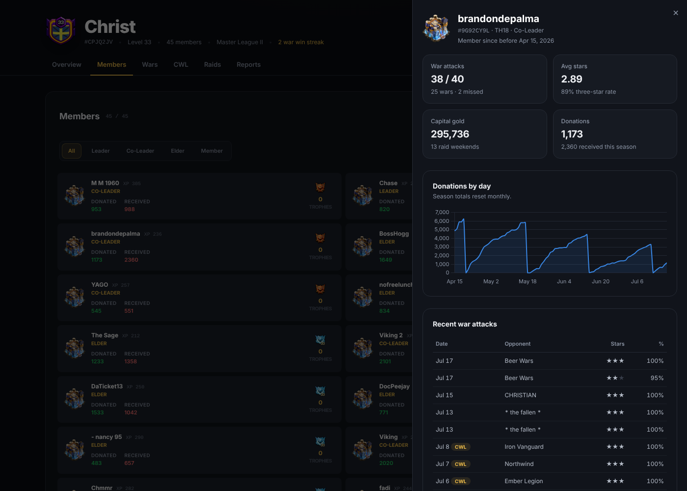

# CoC Clan Stats Dashboard

A dashboard for tracking a Clash of Clans clan: roster history, wars, Clan War League, raid weekends and trend reports, with live win-probability analysis for the current war.

It runs entirely on Cloudflare's free tier. A Worker serves the dashboard, pulls fresh data from the Clash of Clans API every hour, and stores the history in a D1 (SQLite) database. There are no GitHub Actions and no data committed to the repo.

Live example: https://clash.kenaz.dev


## Features

### Overview
Headline numbers (members and 30-day change, current or last war, recent form, capital gold), then the clan profile: description, war record, capital and join requirements.

### Members
The roster filtered by role and sorted by league, trophies, Town Hall, XP or donations. Pick any past date to see the roster as it was that day.

Click a member anywhere on the site to open their **player profile**: how long they've been in the clan, war attacks used and missed, average stars and three-star rate, capital gold, donations over time and recent attacks.



### ⚔️ Wars
Every tracked war (regular and CWL), filterable by result and date range.


Each war has a full breakdown:
- **Win probability** for wars in progress, based on:
  - each attacker's month-to-date star average for their likely matchup
  - Town Hall ceiling caps (e.g. TH14 vs TH18 = 1–2 star max)
  - defense insurance when the opponent lacks high-level threats
  - late-war volatility and the score gap vs. stars still available
- Metrics: average stars, average destruction, win probability, cleanup needed
- Both rosters, attacks and defenses, with filters and sorting


### 🛡️ CWL
Clan War League is captured every hour during league week:
- **Group standings** with the +10 star war-win bonus, W-L-D and total destruction
- **Round-by-round results**; click a round for its full war breakdown
- **Member performance**: attacks used, stars, triples, average destruction, stars conceded

The API only exposes the current season's group, so CWL history starts from the first league after deployment.


### 🏆 Raids
Raid weekend summary (attacks, capital gold, stars, damage per player), plus attack and defense logs per district.


### 📈 Reports
- **Membership over time** with weekly joins and departures, and a log of recent roster changes
- **War record by month** (tracked wars plus the public war log)
- **Win rate, average stars, three-star rate and missed attacks** for the selected range
- **War reliability**: attacks used vs. available per member
- **War stars achieved** per war, **stars earned breakdown** and **star conversion rates**
- **Top donors** this season with donation ratio
- **Town Hall spread** of the current roster
- **Raid weekends**: capital gold per weekend

Time ranges: all time, last 90/30/7 days, this month, previous war.


### 📱 Mobile
Every view works on phones.


## How it works

```
Cloudflare Worker (worker/)
 ├─ Cron trigger, hourly ─► Clash of Clans API (via RoyaleAPI proxy) ─► D1 database
 ├─ /api/*                ─► JSON from D1 for the dashboard
 └─ everything else       ─► static dashboard (public/)
```

Each hourly run stores:
- the clan profile and roster (one snapshot per day, so membership and donations can be charted over time)
- the current war
- the CWL group and all of its wars
- the latest raid weekends
- the public war log, which is also used to finalise wars whose last snapshot was taken before they ended

Only the hourly job talks to the Clash of Clans API. The reload buttons on the dashboard just re-read the latest collected data.

Setup is zero-config on the database side: `wrangler deploy` creates the D1 database, and the Worker creates its tables on first use. On a brand-new deployment the Worker also runs a first collection as soon as the site is opened, retrying every 5 minutes until it succeeds, so you don't have to wait for the top of the hour.

## Setup

Requires a free Cloudflare account. Node 18+ if deploying from your own machine.

### 1. Clash of Clans API key
Create a key at [developer.clashofclans.com](https://developer.clashofclans.com) with the IP **45.79.218.79** allowed. That's the [RoyaleAPI proxy](https://docs.royaleapi.com/proxy.html); Cloudflare Workers don't have a fixed IP, so the proxy is what makes the key work.

### 2. Configure
In `wrangler.toml`, set:
- `name`: the name of your Cloudflare Worker
- `CLAN_TAG`: your clan tag, including the `#`

### 3. Deploy

**Option A: from GitHub (auto-deploys on every push)**
1. Cloudflare dashboard → **Workers & Pages → Create → Import a repository** → pick this repo. Keep the deploy command `npx wrangler deploy`.
2. Add the API token as a **runtime** secret: open the Worker → **Settings → Variables and Secrets → Add** → Type **Secret**, name `COC_API_TOKEN`, paste the token, **Deploy**.

> ⚠️ Don't use the **Variables and secrets** box inside **Settings → Build**. Those are only available while building; the running Worker can't see them, and the site will report "COC_API_TOKEN secret is not set".

**Option B: from your machine**
```bash
npm install
npx wrangler login
npx wrangler secret put COC_API_TOKEN    # paste the token when prompted
npm run deploy
```

### 4. Custom domain (optional)
Open the Worker → **Settings → Domains & Routes → Add → Custom domain** (e.g. `clash.example.com`). The domain's DNS must be on Cloudflare.

### Checking it works
Open the site. The header shows when data was last collected, and turns red with **Update failed** if collection is failing; hover over it (or open `/api/status`) to see the error:

| Error | Fix |
|---|---|
| `COC_API_TOKEN secret is not set` | Add the secret under **Settings → Variables and Secrets** (not Build) |
| `accessDenied` / `Invalid authorization` | Allow IP `45.79.218.79` on your API key, or check the token |
| `notFound` on the clan | Check `CLAN_TAG` in `wrangler.toml` |

To change how often data is collected, edit `crons` in `wrangler.toml`.

## Local development
```bash
cp .dev.vars.example .dev.vars             # add your token
npm install
npm run dev                                # http://localhost:8787
curl "http://localhost:8787/__scheduled"   # run the hourly job once
```

## API
| Endpoint | Returns |
|---|---|
| `GET /api/clan` | Latest clan profile with roster |
| `GET /api/members?date=YYYY-MM-DD` | Roster on a given day |
| `GET /api/members/dates` | Days with roster snapshots |
| `GET /api/wars` | Every tracked war (regular + CWL) |
| `GET /api/cwl` | CWL seasons with group and all wars |
| `GET /api/raids` | Raid weekends |
| `GET /api/history` | Daily clan counters, joins/leaves, war log |
| `GET /api/players/:tag` | One member's daily history |
| `GET /api/status` | Result of the last collection |

## Project layout
```
public/       Static dashboard (HTML, CSS, JS modules)
worker/       Cloudflare Worker: API, hourly collector, D1 schema
wrangler.toml Worker name, clan tag, cron schedule, D1 binding
```
