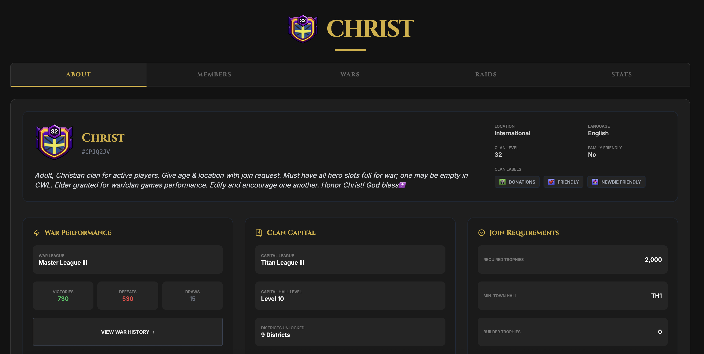
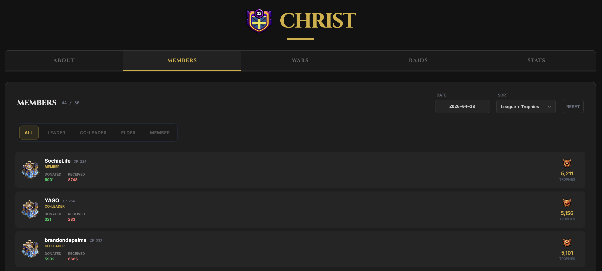
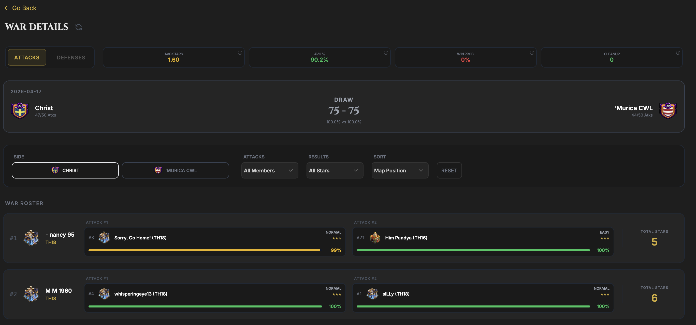
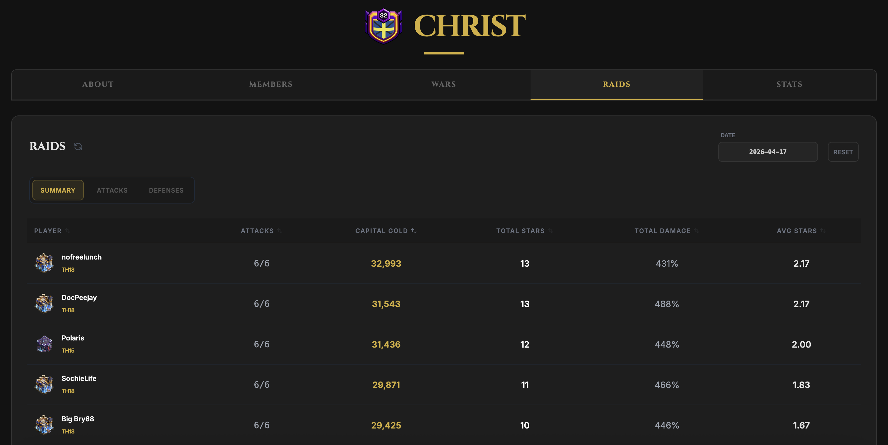
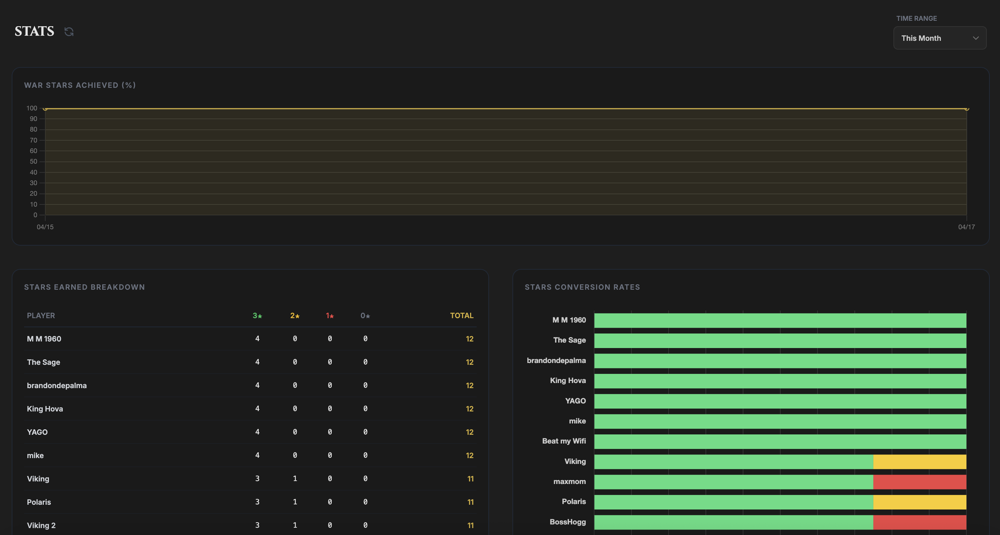

# CoC War Stats Dashboard

A sophisticated dashboard for tracking Clash of Clans performance with advanced analytics and real-time win probability calculations. It runs entirely on Cloudflare's free tier: a Worker serves the dashboard, pulls fresh data from the Clash of Clans API every hour (Cron Trigger), and stores history in a D1 (SQLite) database. No GitHub Actions, no data commits.

See live example: https://clash.kenaz.dev

## Features

### Overview Tab
Headline numbers (members and 30-day change, current/last war, recent form, capital gold) above the clan profile, war performance metrics, league standings, and join requirements.



### Members Tab
Track all clan members with dynamic filtering by role (Leader, Co-Leader, Elder, Member). View donation history and trophy counts with date-based historical snapshots.



### ⚔️ Wars Tab
Deep-dive war analysis with:
- **Advanced Win Probability** - Sophisticated algorithm analyzing:
  - Player Month-to-Date (MTD) star averages
  - Town Hall ceiling caps and hard-cap logic (TH14 vs TH18 = 1-2 star max)
  - Defense insurance calculations
  - Late-war volatility sensitivity
  - Score gap vs remaining potential stars
- War roster comparison (attacks & defenses)
- Metrics: Avg Stars, Avg %, Win Prob., and Cleanup Needed
- Full historical archive of past wars (war history will only show wars that take place after you start using this tool due to API restrictions)



### 🏆 Raids Tab
Seasonal raid tracking with comprehensive player performance metrics:
- Attacks completed and gold earned
- Total damage and destruction percentage
- Average stars per attack
- Summary, Attacks, and Defenses breakdowns



### 🛡️ CWL Tab
Clan War League is captured hourly during league week (the API only exposes the current group):
- **Group standings** with the +10 star war-win bonus, W-L-D and total destruction
- **Round-by-round results** — click a round for the full war breakdown
- **Member performance** — attacks used, stars, triples, average destruction, stars conceded

### 📈 Reports Tab
- **Membership over time** plus weekly joins/departures, and a log of recent roster changes
- **War record by month** (from tracked wars and the public war log)
- **War reliability** — attacks used vs. available and missed attacks per member
- **Top donors** this season with donation ratio
- **Town Hall spread** of the current roster
- **Raid weekends** — capital gold per weekend

Plus the original war charts:
- **War Stars Achieved (%)** - Trend line showing clan star performance over time
- **Stars Earned Breakdown** - Top 25 players with 3★ / 2★ / 1★ / 0★ counts
- **Stars Conversion Rates** - Star conversion efficiency for top 25 players

Time range filtering available (All time, 90/30/7 days, This month, Previous war).

### 👤 Player profiles
Click any member anywhere to open their profile: tenure, war attacks/missed, average stars, capital gold, donations over time and recent attacks.



## How it works

```
Cloudflare Worker (worker/)
 ├─ Cron trigger, hourly ─► Clash of Clans API (via RoyaleAPI proxy) ─► D1 database
 ├─ /api/*                ─► JSON from D1 for the dashboard
 └─ everything else       ─► static dashboard (public/)
```

Each hourly run stores the clan profile and roster (one snapshot per day), the current war, the CWL group and its wars, the latest raid weekends, and the public war log. The war log is also used to finalise wars whose last snapshot was taken before they ended.

Only the hourly job talks to the Clash of Clans API. The dashboard's reload buttons just re-read the latest collected data from the Worker.

The database and its tables are created automatically: `wrangler deploy` provisions the D1 database, and the Worker creates its tables on first use.

## Setup (Cloudflare)

Requires Node 18+ and a free Cloudflare account.

1. **API key.** Create a key at [developer.clashofclans.com](https://developer.clashofclans.com) with the IP **45.79.218.79** allowed ([RoyaleAPI proxy](https://docs.royaleapi.com/proxy.html)). Cloudflare Workers don't have a fixed IP, so the proxy is what makes the key work.
2. **Clan tag.** Set `CLAN_TAG` in `wrangler.toml`.
3. **Deploy.**
   ```bash
   npm install
   npx wrangler login
   npx wrangler secret put COC_API_TOKEN
   npm run deploy
   ```
   Data appears after the next hourly run.
4. **Custom domain (optional).** In the Cloudflare dashboard: **Workers & Pages → clash-of-clans-stats → Settings → Domains & Routes → Add → Custom domain**. The domain's DNS must be on Cloudflare; if it currently points at GitHub Pages, remove that record and disable Pages.
5. **Auto-deploy on push (optional).** **Workers & Pages → clash-of-clans-stats → Settings → Build → Connect** to the GitHub repo, and add `COC_API_TOKEN` there as a secret.

To change the schedule, edit `crons` in `wrangler.toml` and redeploy.

## Local development
```bash
cp .dev.vars.example .dev.vars             # add your token
npm run dev                                # http://localhost:8787
curl "http://localhost:8787/__scheduled"   # run the hourly job once
```

## API
| Endpoint | Returns |
|---|---|
| `GET /api/clan` | Latest clan profile with roster |
| `GET /api/members?date=YYYY-MM-DD` / `GET /api/members/dates` | Roster on a day / days available |
| `GET /api/wars` | Every tracked war (regular + CWL) |
| `GET /api/cwl` | CWL seasons with group and all wars |
| `GET /api/raids` | Raid weekends |
| `GET /api/history` | Daily clan counters, joins/leaves, war log |
| `GET /api/players/:tag` | One member's daily history |
| `GET /api/status` | Time of the last collection |

## Advanced Analytics

### Win Probability Algorithm
The dashboard features a sophisticated win probability calculator that goes beyond simple star counting:

- **Terminal Conditions**: Immediate 100% or 0% when war outcomes are mathematically decided
- **Player-Specific Expected Values**: Uses each attacker's historical MTD star average for their specific matchup
- **Opponent Sampling**: Calculates opponent threat level based on their average stars per attack
- **TH Ceiling Caps**: Models realistic star potential based on attacker/target TH level gaps
  - 4+ TH levels below target: 1-2 star max
  - 3 TH levels below: 2-3 star realistic
- **Defense Insurance**: Increases win probability when ahead if opponent lacks high-level threats remaining
- **Late-War Volatility**: Amplifies sensitivity as attacks decrease (late failures cause larger swings)
- **Score Gap vs Potential**: Weighs current star difference against total possible remaining stars

### Data Persistence
- Hourly snapshots stored in Cloudflare D1 (SQLite)
- One roster snapshot per member per day for membership and donation trends
- Complete war, CWL and raid history for statistical aggregation
