# CoC Clan Stats Dashboard

A dashboard for tracking a Clash of Clans clan: wars with live win/draw/loss predictions, Clan War League with a member scorecard, raid weekends, roster history and exportable reports. Works on phones and desktops, in light and dark mode.

It runs entirely on Cloudflare's free tier. A Worker serves the dashboard, pulls fresh data from the Clash of Clans API every hour, and stores the history in a D1 (SQLite) database. There are no GitHub Actions and no data committed to the repo.

Live example: https://clash.kenaz.dev

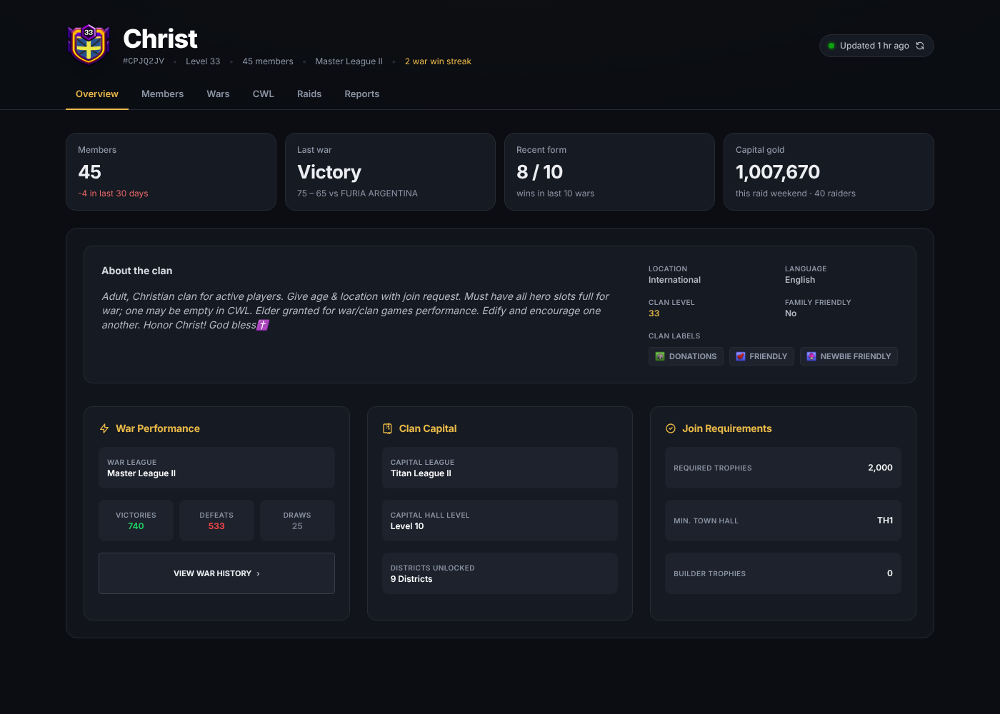

## Features

###  Overview
Headline numbers (members and 30-day change, recent form, all-time wins, capital gold), the current war with its prediction, recent results, the membership trend and the clan profile.

###  Wars
The current war sits on top: preparation or battle day, a countdown, and the **predicted chance of a win, draw or loss**. Below it is the full war history (tracked wars plus the clan's public war log), filterable by result, war type and opponent. Results only appear once a war has ended.

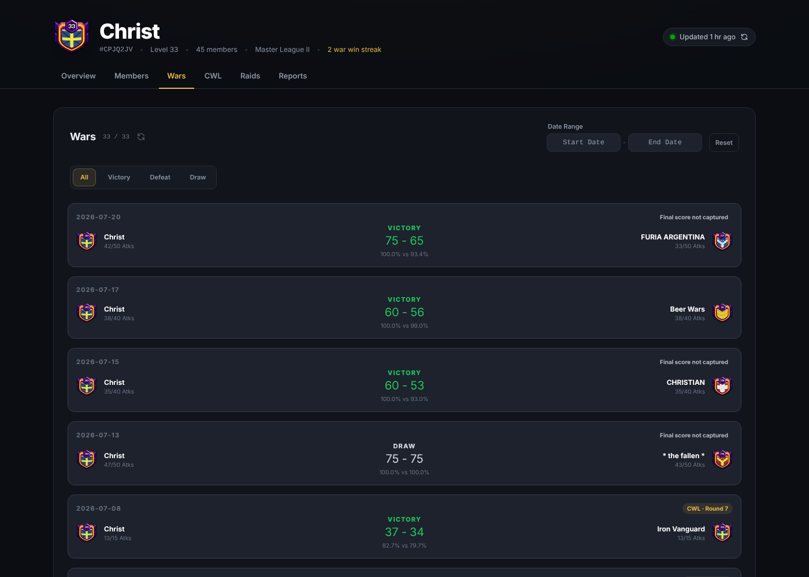

Each tracked war opens a breakdown: scoreboard, prediction (with how it was calculated), averages, three-stars, attacks left or missed, bases to clean up, and the line-up three ways: **our attacks**, **their attacks**, and **base-by-base matchups**. Export any war to Excel or PDF.

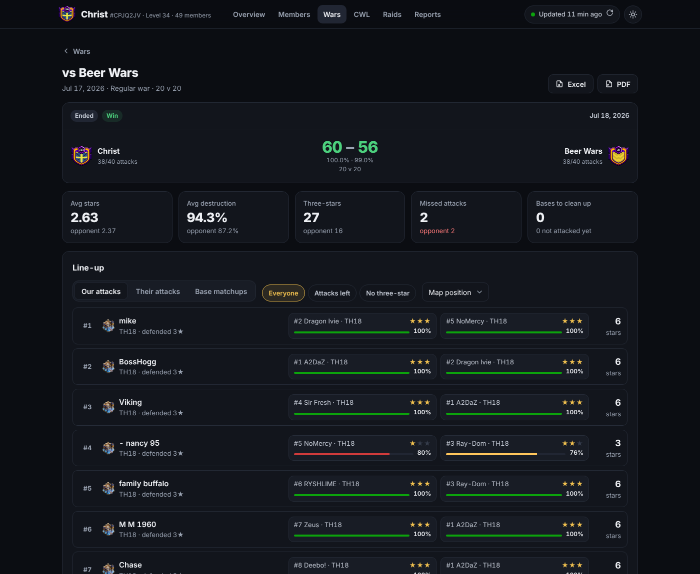

#### How the prediction works
Every remaining attack is simulated 2,000 times (1,200 for wars bigger than 30 v 30):
- **Attacker skill.** Our clan's level comes from its war log. Each member is then adjusted up or down from that level by their own tracked attacks, allowing for the Town Halls they hit. The opponent's level comes from **their public war log**, which the Worker fetches when a war starts. If their log is private, it comes from their win/loss record; with no data at all, from how our recent opponents performed against us. Attacks they make during the war refine it further.
- **Town Hall gap.** Attacking up is penalised and capped; attacking down helps a little.
- **Attack usage.** How often each side actually uses its attacks.
- **Form.** Every run draws each clan's level from its recent wars, so good and bad days, perfect clears that end in draws, and upsets happen as often as they really do. Backtested on our last 30 wars, the model gives 44% win / 50% draw / 6% loss against the actual 47% / 40% / 13%.

Stars already on the board are kept; only the remaining attacks are simulated.

###  CWL
Clan War League is captured every hour during league week:
- **Standings & rounds:** group table (with the +10 star war-win bonus, W-L-D, destruction) and our result in each round
- **Member scorecard:** a spreadsheet of every lineup slot per round (target, Town Hall gap, stars, destruction, missed attacks, stars conceded), scored with **rules you set** (points per star, per % destruction, three-star bonus, attacking up, missed attack, defense)

The scorecard's **Excel export keeps the scoring live**: the weights sit on a *Scoring* sheet, every attack's score is a formula, and the summary uses `SUMIFS`, so you can keep adjusting the rules in Excel.

The API only exposes the current season's group, so CWL history starts from the first league after deployment.

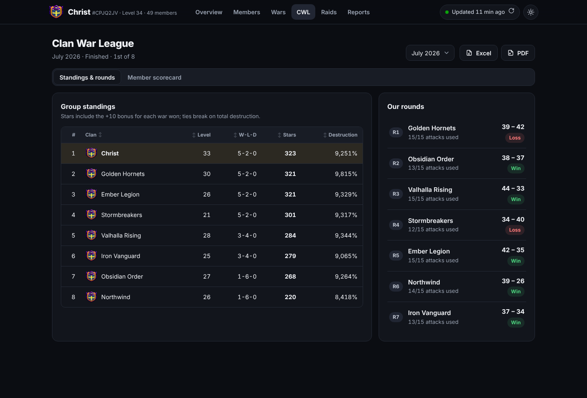

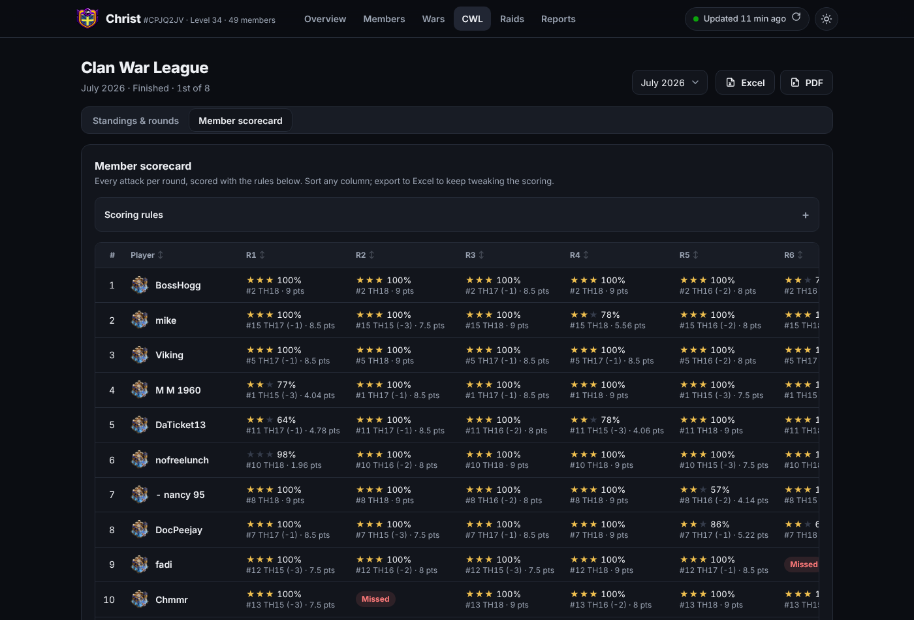

###  Reports
Pick a report, view it, export it to **Excel or PDF**:

| Report | What's in it |
|---|---|
| Member war performance | Attacks used/missed, usage %, stars, avg stars, 3-star rate, avg destruction, TH targeted, stars conceded. Filter by time range, war type, current/former members |
| Clan war statistics | Record and win rate, star rate, wins/losses/draws by month, stars won per war, every war result |
| CWL scorecard | The scorecard above, for any recorded season |
| Membership | Members per day, weekly joins/departures, roster change log, tenure |
| Donations | Donated, received, net and ratio for any snapshot date |
| Raid Weekends | Capital gold per weekend and a player-by-weekend gold sheet |
| Roster composition | Town Hall levels, roles and leagues |

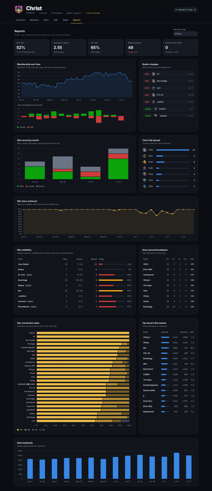

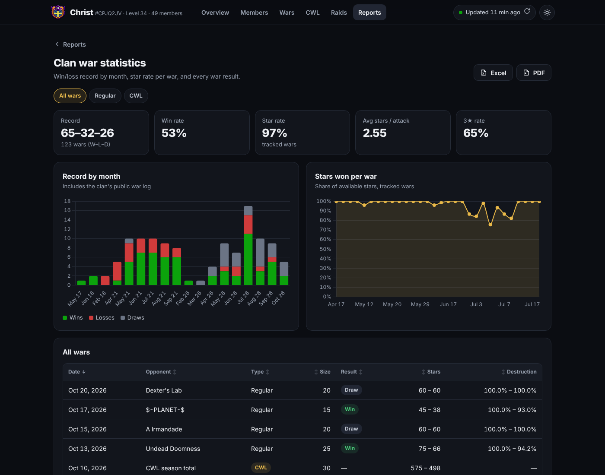

###  Members & player profiles
Search, filter by role, sort, and look at the roster on any past date. Each player has a profile: tenure, war attacks and misses, average stars, capital gold, donations over time and every war attack, also exportable.

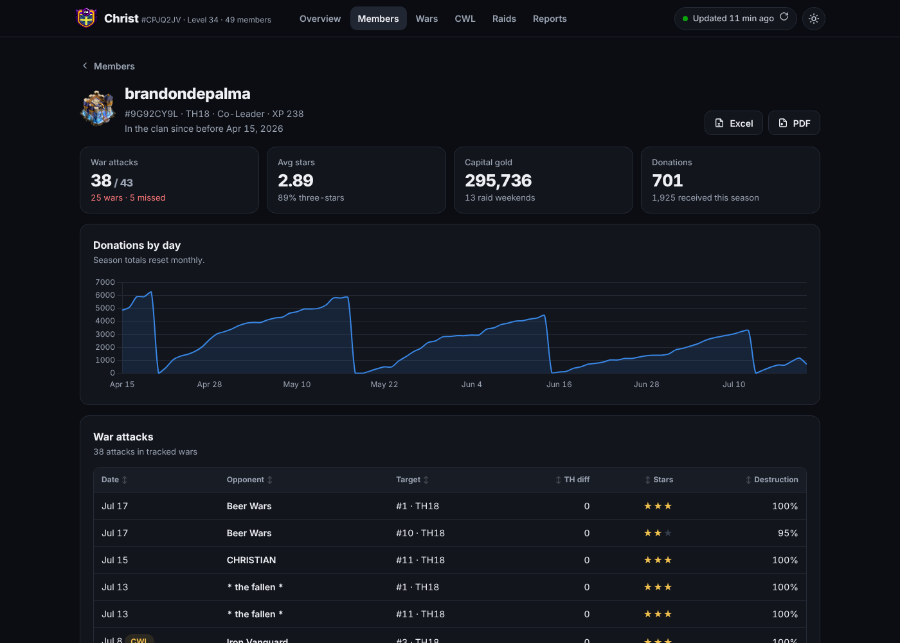

###  Raids
Per-weekend player summary (attacks, capital gold, stars, damage), our raids on other capitals, and defenses.

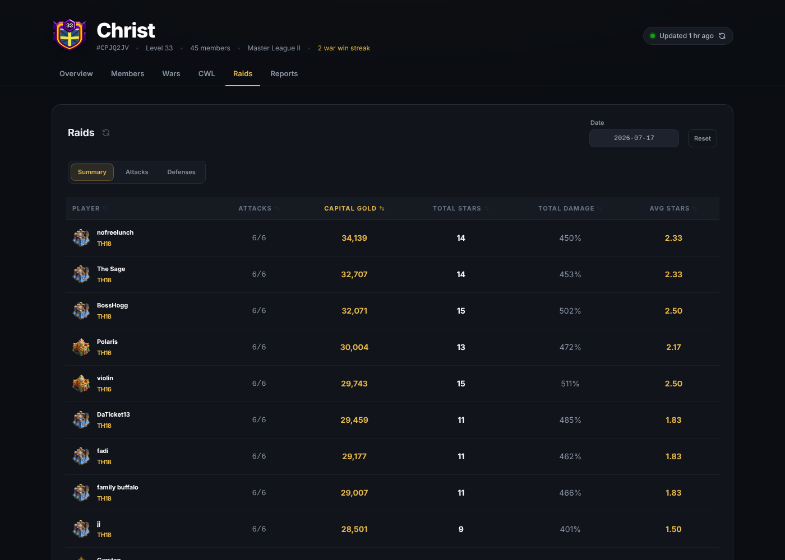

###  Mobile, light/dark and accessibility
- Bottom tab bar on phones, top navigation on desktop
- Light and dark themes: follows the device, with a toggle in the header
- Built for keyboard and screen readers: skip link, landmarks, labelled controls and charts, sortable tables announced with `aria-sort`, visible focus, and reduced-motion support. Every page passes an automated WCAG 2.1 AA audit (axe-core) in both themes, at phone and desktop widths

<p>
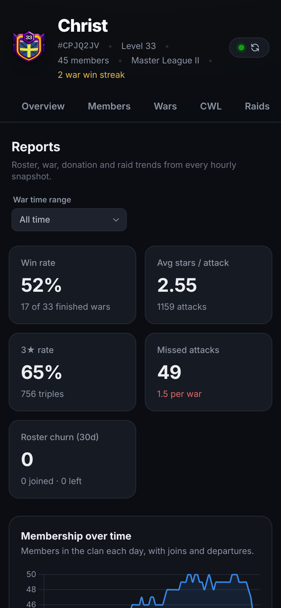
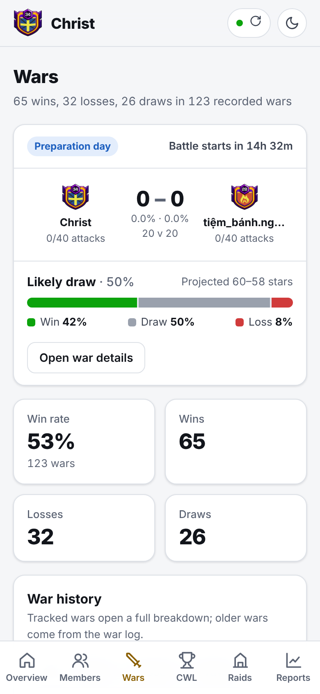
</p>

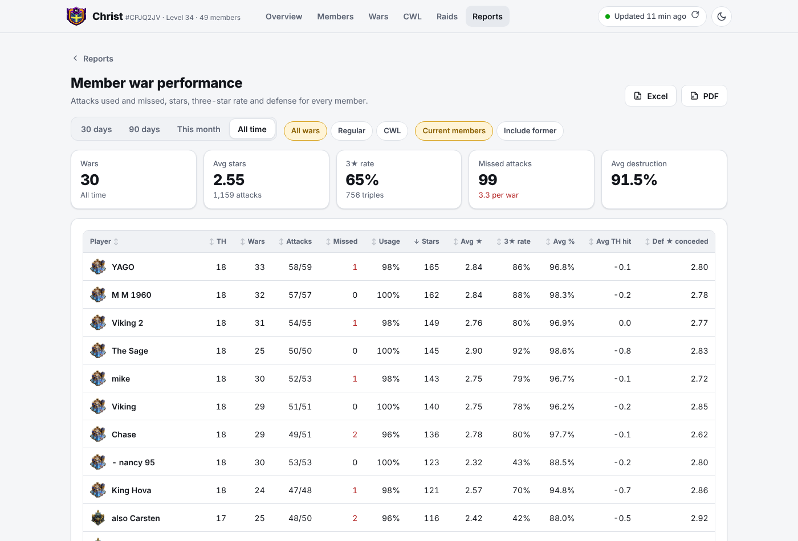

## How it works

```
Cloudflare Worker (worker/)
 ├─ Cron trigger, hourly ─► Clash of Clans API (via RoyaleAPI proxy) ─► D1 database
 ├─ /api/*                ─► JSON from D1 for the dashboard
 └─ everything else       ─► static dashboard (public/)
```

Each hourly run stores:
- the clan profile and roster (one snapshot per day, so membership and donations can be charted over time)
- the current war, plus the opponent's clan profile and public war-log summary (for the prediction)
- the CWL group and all of its wars
- the latest raid weekends
- the public war log, which is also used to finalise wars whose last snapshot was taken before they ended

Only the hourly job talks to the Clash of Clans API. The reload buttons on the dashboard just re-read the latest collected data.

Setup is zero-config on the database side: `wrangler deploy` creates the D1 database, and the Worker creates its tables on first use. On a brand-new deployment the Worker also runs a first collection as soon as the site is opened, retrying every 5 minutes until it succeeds, so you don't have to wait for the top of the hour.

## Setup

Requires a free Cloudflare account. Node 18+ if deploying from your own machine.

### 1. Clash of Clans API key
Create a key at [developer.clashofclans.com](https://developer.clashofclans.com) with the IP **45.79.218.79** allowed. That's the [RoyaleAPI proxy](https://docs.royaleapi.com/proxy.html); Cloudflare Workers don't have a fixed IP, so the proxy is what makes the key work.

### 2. Configure
In `wrangler.toml`, set:
- `name`: the name of your Cloudflare Worker
- `CLAN_TAG`: your clan tag, including the `#`

### 3. Deploy

**Option A: from GitHub (auto-deploys on every push)**
1. Cloudflare dashboard → **Workers & Pages → Create → Import a repository** → pick this repo. Keep the deploy command `npx wrangler deploy`.
2. Add the API token as a **runtime** secret: open the Worker → **Settings → Variables and Secrets → Add** → Type **Secret**, name `COC_API_TOKEN`, paste the token, **Deploy**.

> [!WARNING]
> Don't use the **Variables and secrets** box inside **Settings → Build**. Those are only available while building; the running Worker can't see them, and the site will report "COC_API_TOKEN secret is not set".

**Option B: from your machine**
```bash
npm install
npx wrangler login
npx wrangler secret put COC_API_TOKEN    # paste the token when prompted
npm run deploy
```

### 4. Custom domain (optional)
Open the Worker → **Settings → Domains & Routes → Add → Custom domain** (e.g. `clash.example.com`). The domain's DNS must be on Cloudflare.

### Checking it works
Open the site. The header shows when data was last collected, and turns red with **Update failed** if collection is failing; hover over it (or open `/api/status`) to see the error:

| Error | Fix |
|---|---|
| `COC_API_TOKEN secret is not set` | Add the secret under **Settings → Variables and Secrets** (not Build) |
| `accessDenied` / `Invalid authorization` | Allow IP `45.79.218.79` on your API key, or check the token |
| `notFound` on the clan | Check `CLAN_TAG` in `wrangler.toml` |

To change how often data is collected, edit `crons` in `wrangler.toml`.

## Local development
```bash
cp .dev.vars.example .dev.vars             # add your token
npm install
npm run dev                                # http://localhost:8787
curl "http://localhost:8787/__scheduled"   # run the hourly job once
```

## API
| Endpoint | Returns |
|---|---|
| `GET /api/clan` | Latest clan profile with roster |
| `GET /api/members?date=YYYY-MM-DD` | Roster on a given day |
| `GET /api/members/dates` | Days with roster snapshots |
| `GET /api/wars` | Every tracked war (regular + CWL) |
| `GET /api/cwl` | CWL seasons with group and all wars |
| `GET /api/raids` | Raid Weekends |
| `GET /api/history` | Daily clan counters, joins/leaves, war log |
| `GET /api/players/:tag` | One member's daily history |
| `GET /api/status` | Result of the last collection |

## Project layout
```
public/       Static dashboard (HTML, CSS, JS modules; no build step)
  js/views/   One module per page
  js/predict.js  War outcome simulation
worker/       Cloudflare Worker: API, hourly collector, D1 schema
wrangler.toml Worker name, clan tag, cron schedule, D1 binding
```
